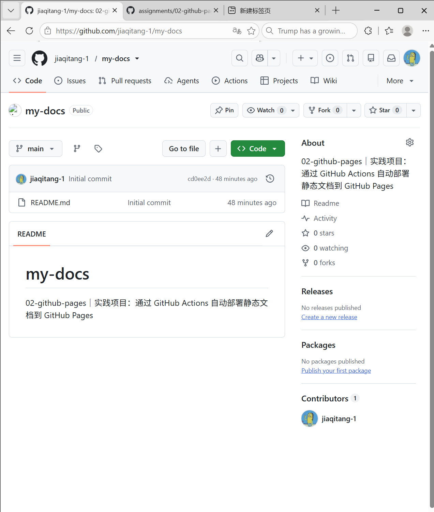

# 实践项目 2 个人实验报告

## 基本信息

- GitHub 登录名：jiaqitang-1
- [个人仓库](https://github.com/jiaqitang-1/my-docs)
- 最终网站地址：部署后填写

## 实践过程与截图

依次记录公开仓库、项目结构与 MkDocs 配置、本地预览、Pages 设置、首次 Actions 部署、公开网站四页检查，以及第二次推送和网站更新。将实际截图保存到 `images/`，配上操作、原因和结果。

- 第二次推送的提交链接：待填写
- 第二次自动部署的 Actions 运行链接：待填写

### 1. 创建公开仓库

仓库首页显示所有者 jiaqitang-1、仓库名 my-docs、main 分支和 Public 标识。该仓库用于保存源文件、部署配置和实验报告。

## 问题与解决

待填写实际遇到的问题和解决过程，或记录检查过的配置与日志。

## 原理理解

1. `docs/` 和 `site/` 分别保存什么？为什么不用手工修改 `site/`？
2. 工作流在什么情况下自动运行？
3. `build` 和 `deploy` 分别做什么？
4. 只修改报告会触发部署吗？为什么？
5. 为什么本方案无需创建 `gh-pages` 分支？
