# 实践项目 2 个人实验报告

## 基本信息

- GitHub 登录名：`jiaqitang-1`
- [源码仓库](https://github.com/jiaqitang-1/my-docs)
- [公开网站](https://jiaqitang-1.github.io/my-docs/)

## 实践过程

### 1. 创建公开仓库

仓库首页显示所有者 `jiaqitang-1`、默认分支 `main` 和 `Public` 标识。仓库用于保存站点源码、部署配置和实验报告。

### 2. 编写四页文档并配置导航

`docs/` 包含首页、关于、使用指南和 API 参考。首页用相对链接指向其他三页，关于页用表格说明各工具的分工，API 参考页用 JSON 代码块展示示例返回值。`mkdocs.yml` 的 `nav` 将四个 Markdown 文件加入导航，`site_url` 指向 Pages 项目站点。
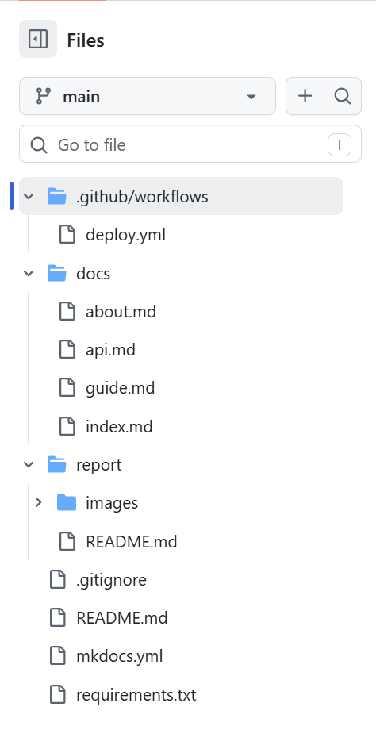
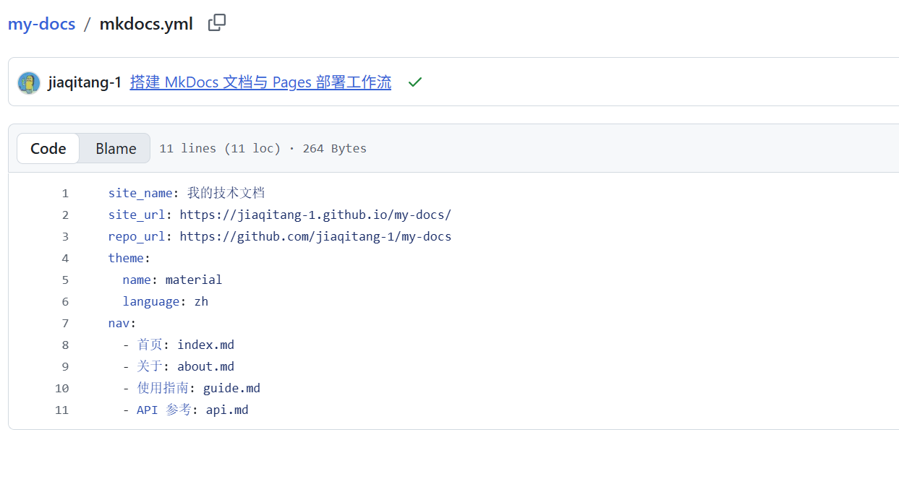

### 3. 本地严格构建

使用当前机器上的 Python 3.14 在虚拟环境安装 `requirements.txt` 中的依赖，然后运行 `python -m mkdocs build --strict`。终端报告构建成功，生成的网页位于 `site/`。云端工作流使用 Python 3.12。
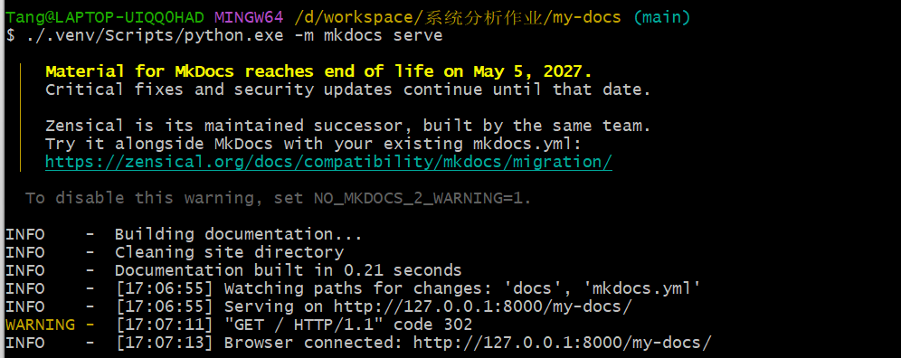
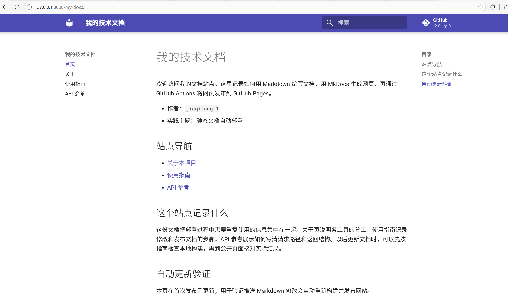
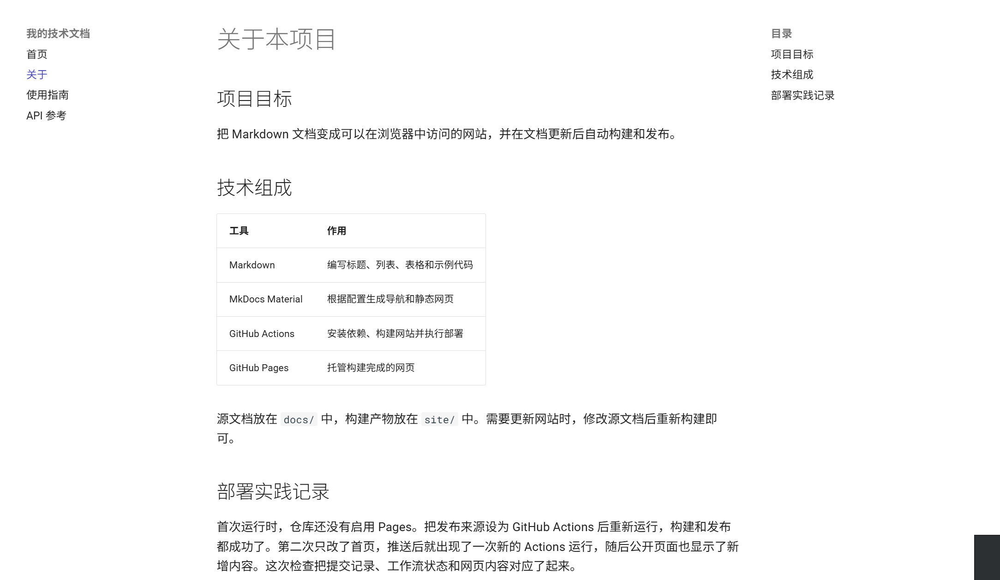
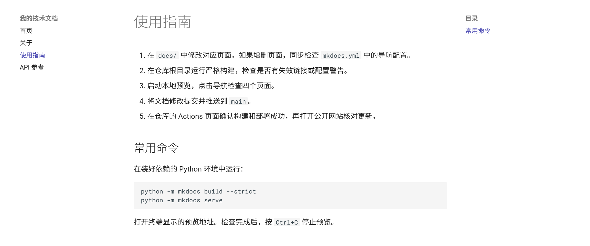
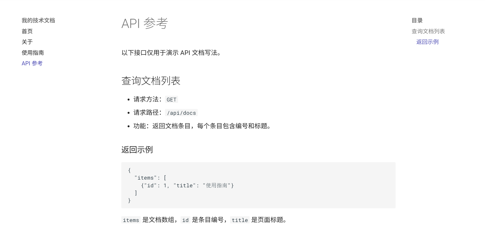

### 4. 设置发布来源

将个人仓库的 Pages 发布来源设置为 GitHub Actions。工作流上传 `site/` 作为部署产物，部署任务再将该产物发布为网站。
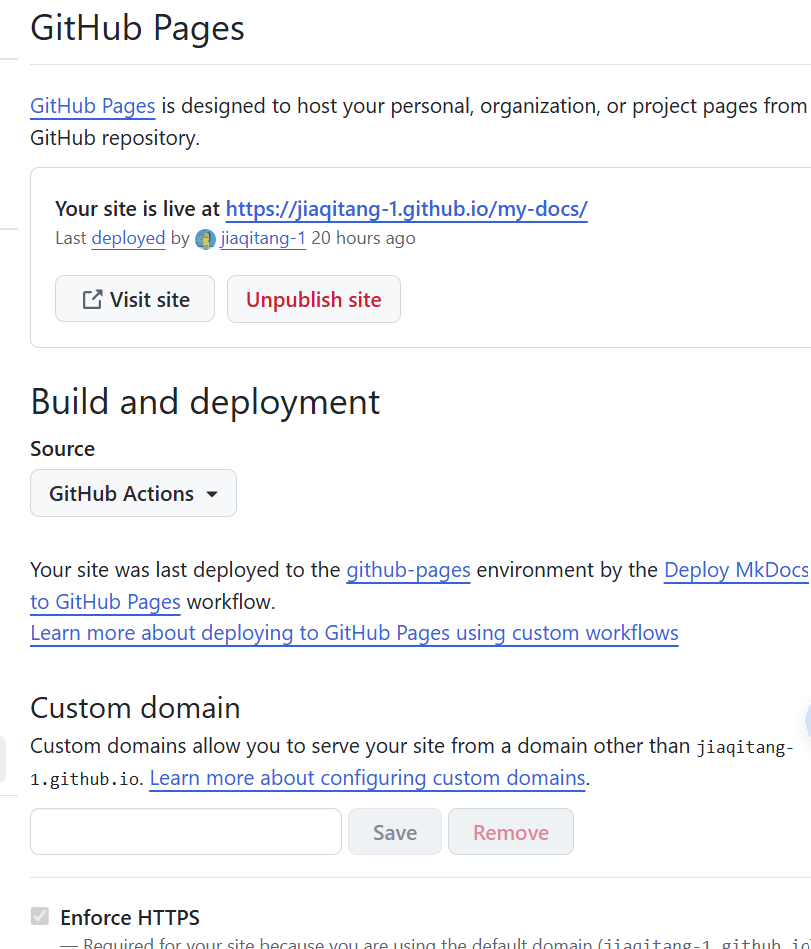

### 5. 首次构建和部署

首次推送时仓库尚未开启 Pages。设置发布来源后重试首次运行，`build` 和 `deploy` 均成功。 [首次 Actions 运行](https://github.com/jiaqitang-1/my-docs/actions/runs/42822890547)
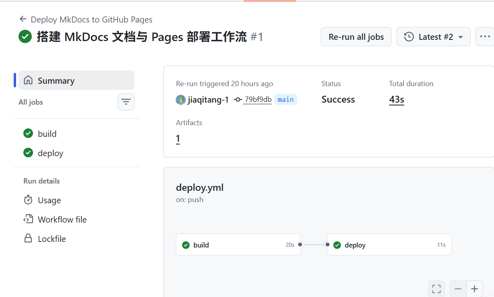

### 6. 检查公开网页

公开站点四页均返回 HTTP 200。本地预览逐页检查了导航、首页链接、关于页表格和 API 页的 JSON 代码块。
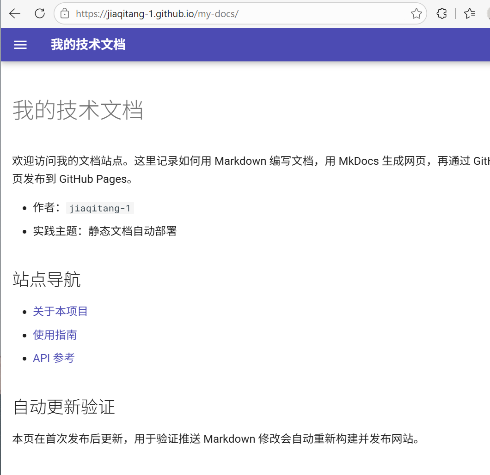

### 7. 验证推送后自动更新

在首页增加「自动更新验证」一节，只提交该 Markdown 文件并推送到 `main`。新工作流由 `push` 事件自动触发。构建和部署成功后，公开首页返回的页面包含新增标题。

- [第二次推送的提交](https://github.com/jiaqitang-1/my-docs/commit/b10f132)
- [第二次自动部署的 Actions 运行](https://github.com/jiaqitang-1/my-docs/actions/runs/42823315302)

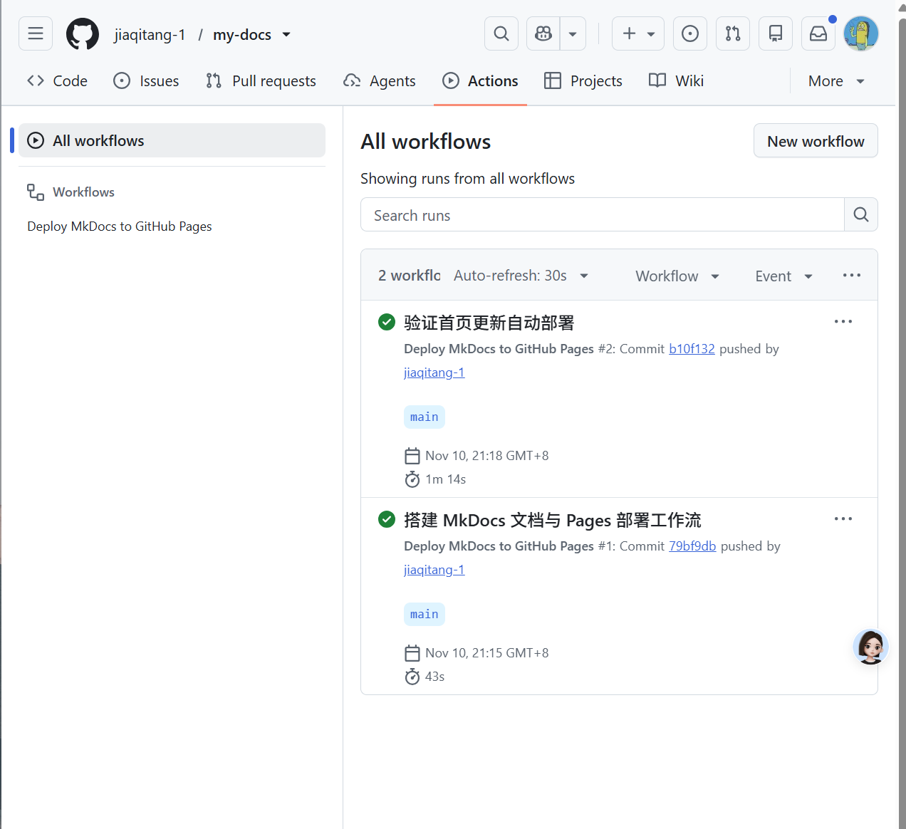

第 6 节的公开首页截图显示了这次部署新增的「自动更新验证」。随后提交 [70c7058](https://github.com/jiaqitang-1/my-docs/commit/70c7058) 再次修改了首页，[对应的 Actions 运行](https://github.com/jiaqitang-1/my-docs/actions/runs/42995375568) 由推送触发并成功结束。下面两图记录该次提交的推送和源码预览。
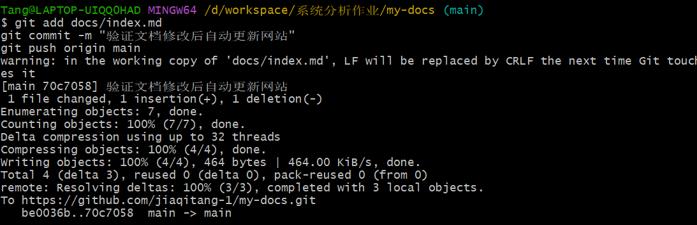
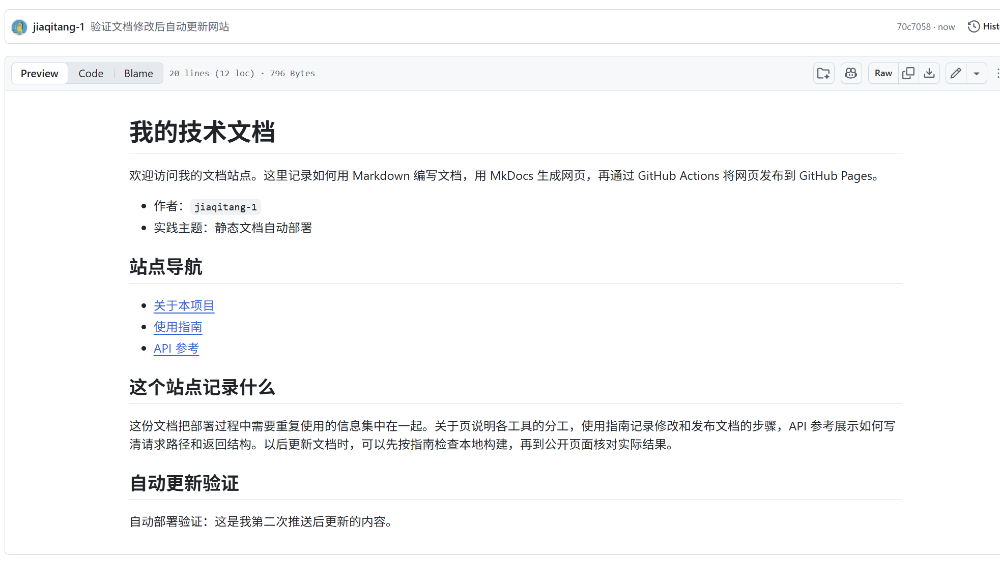

## 问题与解决

- 本机的 Python 启动器找不到 3.12，且首次创建的虚拟环境未装上 pip。使用系统 Python 的 pip 将依赖安装进项目虚拟环境，之后严格构建成功。
- 第一次运行时 Pages 尚未启用。把发布来源设置为 GitHub Actions 并重试后，两项任务都完成。

## 原理理解

1. `docs/` 保存可编辑的 Markdown 源文件，`site/` 保存 MkDocs 生成的 HTML 和资源。重新构建会替换生成文件，因此应修改源文档。
2. 推送到 `main`，且改动命中 `docs/**`、`mkdocs.yml`、`requirements.txt` 或工作流文件时，工作流会自动运行。也可通过 `workflow_dispatch` 手动运行。
3. `build` 安装依赖、严格构建并上传 `site/`。依赖它的 `deploy` 将上传的构建产物发布到 Pages。
4. 只改报告不会触发部署，因为 `report/` 不在工作流的推送路径筛选范围内。
5. Pages 的发布来源是 GitHub Actions，部署任务直接发布构建产物，因此无需把生成的文件提交到 `gh-pages` 分支。
